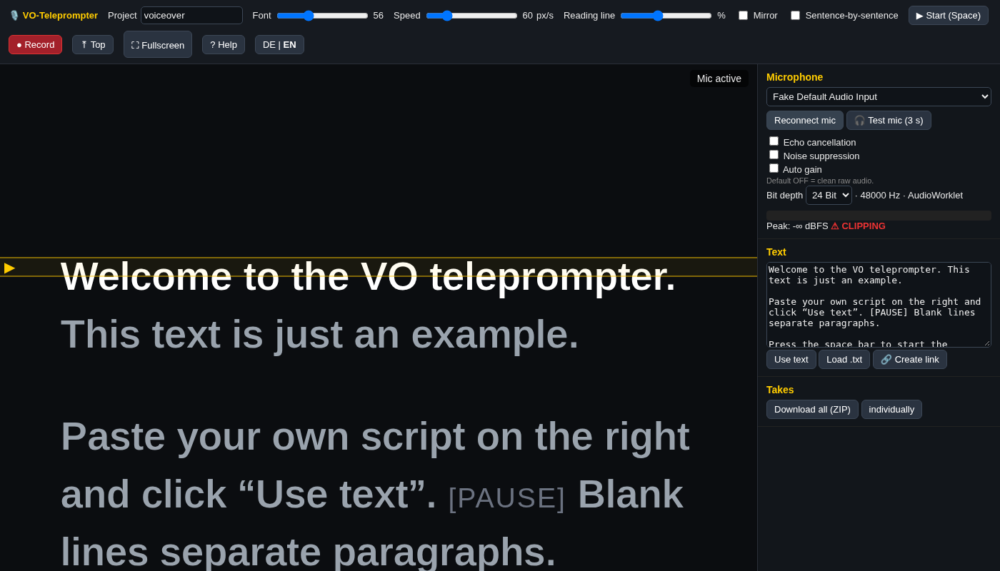

# VO-Teleprompter

A free, single-page browser teleprompter that records **clean, uncompressed WAV voiceovers** while your script scrolls. No install, no account, no server-side processing.



## Features

- **Teleprompter**: large text, font-size slider, adjustable scroll speed, reading line/focus band, mirror mode, dark theme, fullscreen, 3-2-1 countdown. Manual scrolling at any time.
- **Recording**: microphone picker, echo cancellation / noise suppression / auto gain (all **off** by default for raw audio), live level meter with clipping warning, a 3-second **mic test**.
- **Clean audio**: 48 kHz mono WAV, 24-bit or 16-bit, captured via AudioWorklet (fallbacks: ScriptProcessor, then MediaRecorder → decoded to WAV).
- **Takes**: unlimited takes with playback, rename, delete, download, or **download all as ZIP** (built-in, no library).
- **Cutting aid**: every take comes with a JSON sidecar containing sentence/paragraph timestamps.
- **Sentence-by-sentence mode**: each sentence becomes its own take (Enter = next, R = redo).
- **Share links**: put the script into the URL — click **🔗 Create link** or use `tools/make_link.py`.
- **Bilingual UI** (German / English, auto-detected, switchable), touch buttons for phones and tablets.
- One HTML file plus one small worklet script, no external dependencies, no CDN, no tracking.

## Privacy

- Script text travels **only in the URL hash** (`#…`). Browsers never send the hash to the server.
- Audio is recorded and encoded **entirely in your browser**. Nothing is uploaded; files only leave your device when you download them.
- No cookies, analytics or third-party requests. Only the UI language preference is stored in `localStorage`.

## Usage

Serve the folder over HTTPS (e.g. GitHub Pages) or `localhost` — browsers block the microphone on `file://`.

```bash
python3 -m http.server 8000   # then open http://localhost:8000/
```

1. Click **Enable mic** (allow access), optionally **Test mic**.
2. Paste your text and click **Use text** (blank line = new paragraph, `[PAUSE]` = marker shown in gray).
3. Press **Space** → countdown → speak. Press **Space** again to stop.
4. Download the takes (WAV + JSON).

### Share links

```
https://<host>/<path>/#p=<project>&t=<z|b><base64url>
```

- `p` – project name, used in file names (`vo_<project>_take01_<date>.wav`)
- `t` – UTF-8 text, `z` = raw-deflate compressed, `b` = uncompressed; base64url-encoded
- Alternative: `?src=<url-to-a-.txt>` (the file must allow CORS)

Generate a link in the page (**🔗 Create link**) or on the command line:

```bash
python3 tools/make_link.py myproject script.txt --base https://<host>/<path>/
```

About 100 words result in a link of roughly 600 characters.

## Keyboard shortcuts

| Key | Action |
|---|---|
| Space | Start (countdown + recording) / stop |
| ↑ / ↓ | Speed − / + |
| PgUp / PgDn, mouse wheel | Scroll manually |
| Home | Back to top |
| + / − | Font size |
| M / F | Mirror / fullscreen |
| Enter / R | Sentence mode: next sentence / redo sentence |
| Esc | Stop |
| H or ? | Help |

On touch devices use the buttons at the bottom of the screen.

## Browser support

Chrome, Edge, Brave and Firefox (desktop), Safari on macOS and iOS/iPadOS (14.5+). Compressed share links need `CompressionStream` (Chrome 80+, Firefox 113+, Safari 16.4+).

## Troubleshooting: microphone

- **Permission denied**: click the lock/site-settings icon next to the address bar → Microphone → Allow → reload.
- **Windows**: Settings → Privacy & security → Microphone → enable *Microphone access*, *Let apps access* and *Let desktop apps access*.
- **Chrome / Edge / Brave**: check `chrome://settings/content/microphone` (`edge://…`, `brave://…`).
- **Brave**: if still blocked, click the lion icon (Shields) and disable Shields for this site.
- **Opened as a file?** Use the HTTPS or localhost URL — `file://` is blocked.
- **Busy device**: close Zoom/Teams/OBS or other apps using the mic.

## Kurz auf Deutsch

Ein kostenloser Browser-Teleprompter, der beim Ablesen saubere WAV-Sprachaufnahmen (48 kHz, mono, 24/16 Bit) erstellt. Text einfügen oder per Link übergeben (**🔗 Link erzeugen**), **Mikro aktivieren**, **Leertaste** drücken, nach dem Countdown sprechen. Jeder Take enthält eine JSON-Datei mit Satz-Zeitmarken. Der Text steht nur im URL-Hash, die Aufnahme bleibt im Browser – es wird nichts hochgeladen. Wird das Mikrofon blockiert: Schloss-Symbol → Mikrofon → Zulassen; unter Windows *Einstellungen → Datenschutz & Sicherheit → Mikrofon* prüfen; in Brave ggf. Shields für die Seite ausschalten. Die Oberfläche ist zweisprachig (DE/EN).

## License

MIT © Armin Dittmann
